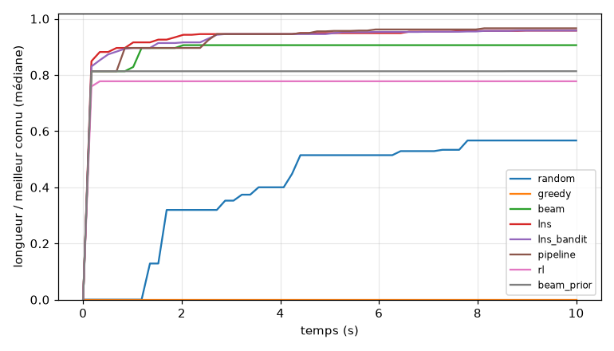

# Rapport de benchmark (phase 7, M3)

Généré par `benchmarks/report.py` à partir d'un fichier de résultats ; ne pas modifier à la main.
Reproduction : `uv run python -m benchmarks.train_rl` puis `uv run python -m benchmarks.run --budget 10 --seeds 10 --policy outputs/rl/policy.zip` puis `uv run python -m benchmarks.report`.

## Protocole

- Budget : **10 s de temps mur par exécution**, identique pour toutes les méthodes ; 10 graines par couple méthode × instance ; 8 instances de test figées (`benchmarks/instances/default.json`).
- Machine : macOS-26.7.1-arm64-arm-64bit, 10 cœurs, Python 3.11.15, 8 exécutions en parallèle (un thread chacune). Le temps d'inférence du RL compte dans le budget ; son temps d'entraînement est rapporté à part.
- Code : `eb55457f78` (arbre modifié) ; catalogue `ae223b9405a6`.
- Chaque circuit rendu est **exporté en JSON puis revalidé par le validateur complet** dans le processus parent. Circuits invalides : **0** (doit être 0). Exécutions qui dépassent le budget de plus de 15 % + 1 s : 0.
- Score normalisé = longueur / meilleur circuit connu sur l'instance (toutes méthodes et graines confondues) ; 0 si la méthode n'a trouvé aucun circuit valide.

Méthodes :

- `random` : rollouts aléatoires masqués (aucune graine de départ)
- `greedy` : pièce valide la plus longue, ε-glouton (aucune graine de départ)
- `beam` : seed en stade puis Beam Search (largeur 200)
- `lns` : seed en stade puis LNS
- `lns_bandit` : LNS dont l'opérateur et la taille de fenêtre sont choisis par bandit de Thompson (adaptatif, sans apprentissage entre instances ; ce n'est pas la formulation c)
- `pipeline` : seeds → beam (20 %) → LNS (service de l'UI)
- `rl` : politique MaskablePPO apprise, rollouts échantillonnés (formulation a)
- `beam_prior` : Beam Search avec la politique apprise comme prior de classement (formulation b)

Politique : 600,000 pas d'entraînement, 6 environnements, graine 0, départ partiel 0.5, façonnage de longueur 0.5, référence de récompense `stock`, 6.4 min sur CPU.

## Résultat agrégé

| Méthode | Score normalisé médian moyen [IC95 %] | Circuit trouvé | Temps jusqu'au 1er circuit (médiane) |
|---|---|---|---|
| random | 0.436 [0.427 ; 0.497] | 57 % | 0.24 s |
| greedy | 0.221 [0.216 ; 0.331] | 31 % | 0.84 s |
| beam | 0.876 [0.874 ; 0.900] | 100 % | 0.00 s |
| lns | 0.946 [0.932 ; 0.958] | 100 % | 0.00 s |
| lns_bandit | 0.940 [0.927 ; 0.954] | 100 % | 0.00 s |
| pipeline | 0.951 [0.938 ; 0.961] | 100 % | 0.00 s |
| rl | 0.793 [0.788 ; 0.810] | 100 % | 0.01 s |
| beam_prior | 0.834 [0.834 ; 0.841] | 100 % | 0.00 s |

## Par instance

Longueur médiane en mm (IQR) ; entre crochets : part des graines qui ont trouvé un circuit.

| Instance | Meilleur connu | random | greedy | beam | lns | lns_bandit | pipeline | rl | beam_prior |
|---|---|---|---|---|---|---|---|---|---|
| golden_a | 7782 | — [0 %] | 5467 (5093–5841) [20 %] | 5546 (5546–6837) [100 %] | 6815 (6514–7332) [100 %] | 6780 (6408–7310) [100 %] | 6815 (6514–7332) [100 %] | 5316 (5316–5316) [100 %] | 5546 (5546–5546) [100 %] |
| golden_b | 8217 | 6837 (6578–7096) [100 %] | 6283 (6075–6628) [100 %] | 7527 (7268–7786) [100 %] | 7872 (7182–7872) [100 %] | 7872 (7355–7872) [100 %] | 8217 (7872–8217) [100 %] | 5316 (5316–5316) [100 %] | 5661 (5661–5938) [100 %] |
| kit_large | 8221 | 3155 (3155–3155) [10 %] | — [0 %] | 6560 (6560–6560) [100 %] | 7379 (7247–7691) [100 %] | 7163 (7120–7340) [100 %] | 7369 (7068–7616) [100 %] | 6006 (6006–6006) [100 %] | 6560 (6560–6560) [100 %] |
| kit_mixed | 5611 | 2096 (2096–2096) [10 %] | — [0 %] | 5029 (5029–5142) [100 %] | 5306 (5306–5392) [100 %] | 5329 (5306–5353) [100 %] | 5306 (5306–5392) [100 %] | 4626 (4626–4626) [100 %] | 5029 (5029–5029) [100 %] |
| kit_oval | 3246 | 3246 (3246–3246) [100 %] | 3246 (3246–3246) [100 %] | 3246 (3246–3246) [100 %] | 3246 (3246–3246) [100 %] | 3246 (3246–3246) [100 %] | 3246 (3246–3246) [100 %] | 3246 (3246–3246) [100 %] | 3246 (3246–3246) [100 %] |
| kit_r2 | 6515 | 3932 (1866–6093) [40 %] | — [0 %] | 4856 (4856–4856) [100 %] | 5825 (5825–5980) [100 %] | 5685 (5478–6084) [100 %] | 5825 (5565–5980) [100 %] | 4626 (4626–4626) [100 %] | 4856 (4856–4856) [100 %] |
| kit_small | 2901 | 2901 (2901–2901) [100 %] | 2556 (2556–2729) [30 %] | 2901 (2901–2901) [100 %] | 2901 (2901–2901) [100 %] | 2901 (2901–2901) [100 %] | 2901 (2901–2901) [100 %] | 2671 (2556–2786) [100 %] | 2901 (2901–2901) [100 %] |
| kit_wide | 7250 | 4767 (4333–5112) [100 %] | — [0 %] | 6837 (6837–6837) [100 %] | 7250 (7250–7250) [100 %] | 7250 (7250–7250) [100 %] | 7250 (7250–7250) [100 %] | 6006 (6006–6679) [100 %] | 6006 (6006–6006) [100 %] |

## Temps pour atteindre 90 % du meilleur connu

| Méthode | Part des exécutions qui y arrivent | Temps médian parmi celles-ci |
|---|---|---|
| random | 29 % | 0.25 s |
| greedy | 14 % | 0.38 s |
| beam | 50 % | 0.46 s |
| lns | 71 % | 0.32 s |
| lns_bandit | 69 % | 0.52 s |
| pipeline | 75 % | 0.82 s |
| rl | 24 % | 0.15 s |
| beam_prior | 25 % | 0.00 s |

## Comparaisons appariées par instance

Écart de score normalisé (A − B), moyenné sur les instances ; IC95 % par bootstrap sur les graines ; test de Wilcoxon sur les médianes par instance (peu de puissance avec si peu d'instances : l'intervalle prime).

| A | B | Écart | IC95 % | p (Wilcoxon) |
|---|---|---|---|---|
| rl | lns | -0.153 | [-0.166 ; -0.130] | 0.016 |
| rl | random | +0.357 | [+0.293 ; +0.375] | 0.109 |
| rl | greedy | +0.572 | [+0.465 ; +0.589] | 0.031 |
| beam_prior | beam | -0.043 | [-0.065 ; -0.036] | 0.500 |
| beam | lns | -0.070 | [-0.080 ; -0.040] | 0.031 |
| pipeline | lns | +0.005 | [-0.012 ; +0.023] | 1.000 |
| lns | random | +0.510 | [+0.444 ; +0.524] | 0.031 |

## Verdict (règles fixes sur les intervalles)

- **rl fait moins bien que lns** (écart -0.153, IC95 % [-0.166 ; -0.130]).
- **rl fait mieux que greedy** (écart +0.572, IC95 % [+0.465 ; +0.589]).
- **beam_prior fait moins bien que beam** (écart -0.043, IC95 % [-0.065 ; -0.036]).
- Aucune différence démontrée entre pipeline et lns (écart +0.005, IC95 % [-0.012 ; +0.023] contient 0).

## Limites

- 8 instances et 10 graines : les intervalles sont larges, une différence modeste peut passer inaperçue.
- Une seule politique entraînée (une graine d'entraînement) : la variance d'entraînement n'est pas mesurée.
- `beam` et `lns` partent d'un seed en stade (D10) ; `random`, `greedy` et `rl` construisent depuis zéro : la comparaison inclut cet avantage de départ.
- Seules les droites et les courbes sont modélisées ; les pièces spéciales des captures sont ignorées.
- « Meilleur connu » n'est pas un optimum prouvé : c'est le meilleur circuit vu dans ce benchmark.
- Contrôle visuel : voir les SVG exportés (`outputs/benchmark/svg/`) avant de se fier à un score.
